<div align="center">

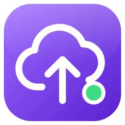

# Coolify Deploy Dashboard

**Deploy, watch and manage your [Coolify](https://coolify.io) apps without leaving VS Code.**
Each repo shows its own Coolify project, with live build logs and one-click deploys. Works directly, on localhost, or behind Cloudflare Access.

[](https://marketplace.visualstudio.com/items?itemName=rahulcode97.coolify-vscode-dashboard)
[&color=8c52ff)](https://open-vsx.org/extension/rahulcode97/coolify-vscode-dashboard)
[](https://github.com/Rahulcode97/Coolify-VScode-Dashboard/actions/workflows/ci.yml)
[](LICENSE)

Works in **VS Code**, **Cursor**, **VSCodium** and **Windsurf**.

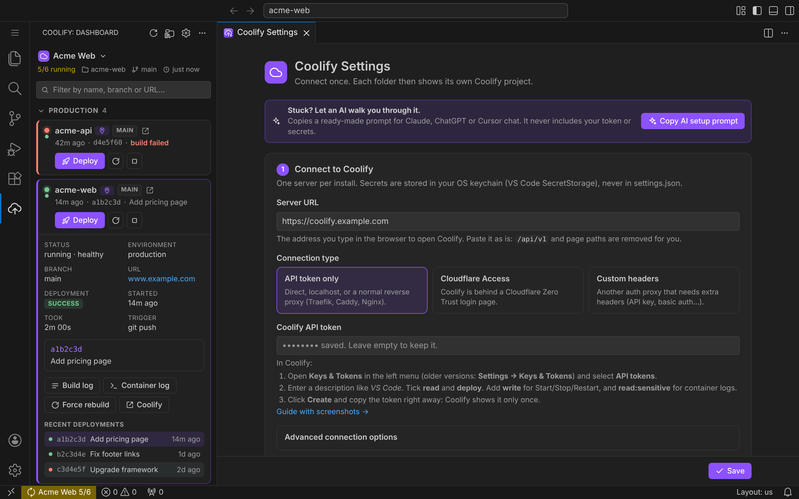

</div>

---

## Why

You push, then switch to the browser, find the project, open the app, wait for the build, and scroll the log… This extension puts all of that in the sidebar, next to your code:

- **The right project, automatically.** Several projects on one Coolify server? The folder you open shows only *its* apps, matched by git remote. No more scrolling past other projects.
- **One-click deploys with live logs.** Deploy, force rebuild or cancel, and watch the build log stream in the sidebar.
- **Catches "successful" failed builds.** Coolify sometimes marks a deployment *finished* even though the build log contains `npm ERR!` or a Docker error, and the old container keeps serving. The extension flags it in red.
- **Works where your Coolify lives.** Direct HTTPS, a bare IP on `:8000`, localhost, a homelab with a self-signed certificate, or **behind Cloudflare Access**.
- **Feels native.** Follows your light, dark or high-contrast theme. Polls only while the sidebar is visible.

## Contents

- [Features](#features)
- [Setup](#setup) (about 3 minutes)
- [Set up with AI](#set-up-with-ai) (copy-paste prompt)
- [How it works](#how-it-works)
- [Using the dashboard](#using-the-dashboard)
- [Optional features](#optional-features)
- [Settings reference](#settings-reference) · [Commands](#commands)
- [Privacy & performance](#privacy--performance)
- [Troubleshooting](#troubleshooting) · [FAQ](#faq) · [Development](#development)

## Features

| | |
|---|---|
| 🗂 **Per-folder projects** | Each workspace folder shows only its Coolify project: auto-detected from the git remote, picked once, or set for the team in `.vscode/settings.json`. |
| 🚀 **Deploy & control** | Deploy, Force rebuild (no cache), Cancel, Start, Stop, Restart for apps, services and databases. |
| 📜 **Logs** | Live build log while deploying, logs of past deployments, and container (runtime) logs. |
| 🟢 **Status at a glance** | Container dot + health dot per resource, "3m ago · a1b2c3d · commit message", running/total in the status bar. |
| 🧱 **Environments** | Resources grouped by environment (production, staging, …); optionally show just one. |
| 🔐 **Secure by default** | Token and secrets in the OS keychain (SecretStorage), never in `settings.json`. Strict webview Content-Security-Policy. |
| ☁️ **Cloudflare Access** | Service-token headers built in; custom headers for other auth proxies. |
| 🧪 **Pre-deploy command** *(optional)* | Run `npm run build` / `npm test` locally before deploying; a failure stops the deploy. |
| 🔀 **Merge & Deploy** *(optional)* | One click: merge `development` → `main` (your branch names), push, deploy. |
| 💻 **Localhost** *(optional)* | Start and stop your local dev servers from the same sidebar. |
| ✨ **AI setup prompt** | One button copies a guided-setup prompt for any AI assistant. It never includes your secrets. |

## Setup

### 1. Install

- **VS Code:** Extensions view → search **Coolify Deploy Dashboard** → Install.
- **Cursor / VSCodium / Windsurf:** same, from Open VSX.
- **Manually:** download the `.vsix` from [Releases](https://github.com/Rahulcode97/Coolify-VScode-Dashboard/releases), then Extensions view → `…` → *Install from VSIX…*

A new **Coolify** icon (a cloud with an arrow) appears in the Activity Bar.

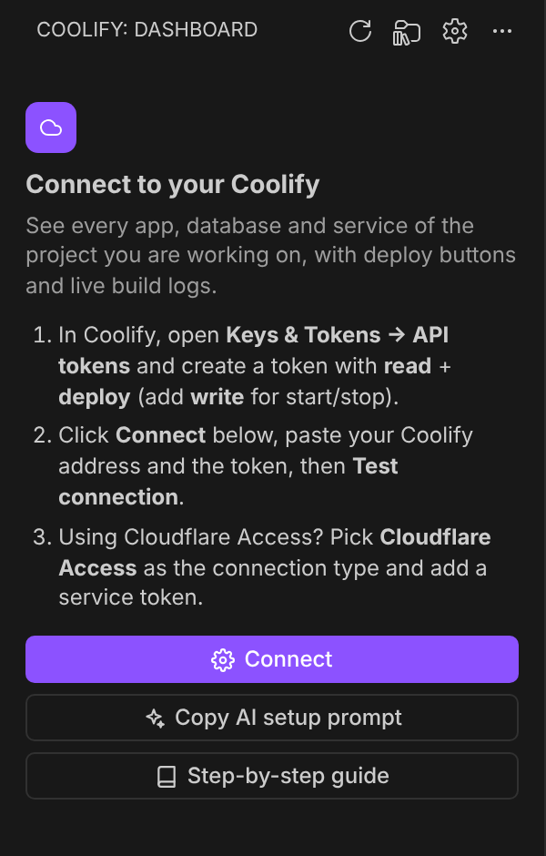

### 2. Create a Coolify API token

In Coolify:

1. Open **Keys & Tokens → API Tokens**.
2. If it says *API access is turned off*, click **Enable API Access** and set **API access** to **Enabled** (Settings → Advanced). This is needed once per server.
3. Click **New Token**. Give it a description, tick **Read** and **Deploy** (add **Write** for start/stop/restart, **Read sensitive data** for container logs), then click **Create Token**.
4. **Copy the token now.** It is shown only once.

<table>
<tr>
<td>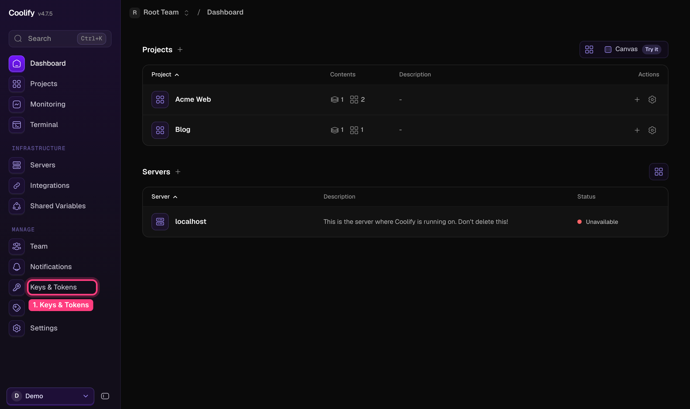</td>
<td>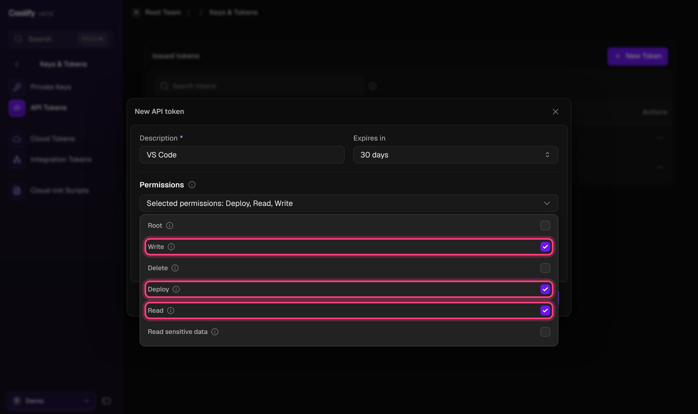</td>
</tr>
<tr>
<td>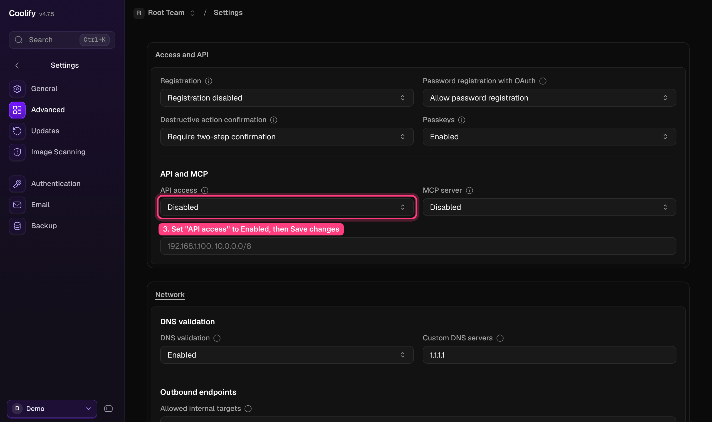</td>
<td>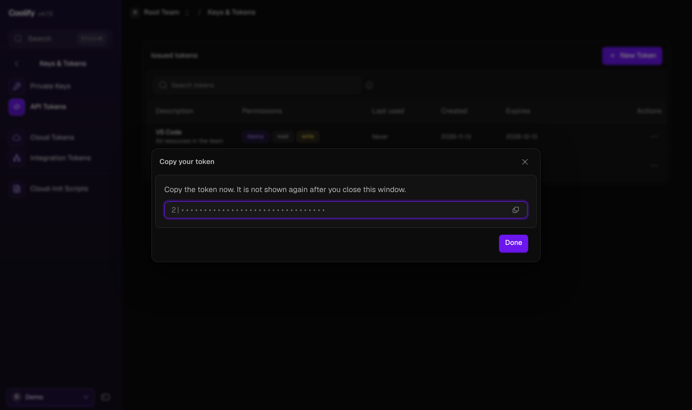</td>
</tr>
</table>

➡ **[Full step-by-step guide with every screenshot](docs/getting-the-api-token.md)**

### 3. Connect

1. Click the **Coolify** icon → **Connect** (or Command Palette → **Coolify: Open Settings**).
2. **Server URL**: the address you open Coolify at: `https://coolify.example.com`, `http://203.0.113.10:8000` or `http://localhost:8000`. If you paste a URL with `/api/v1` or a page path, it's cleaned up for you.
3. **Connection type**:
   - **API token only** for direct, localhost, or a normal reverse proxy.
   - **Cloudflare Access** if a Cloudflare login page sits in front of Coolify → **[Cloudflare guide](docs/cloudflare-access.md)**.
   - **Custom headers** for other auth proxies (Authelia, Authentik, basic auth…).
4. Paste the token → **Test connection** → **Save**.

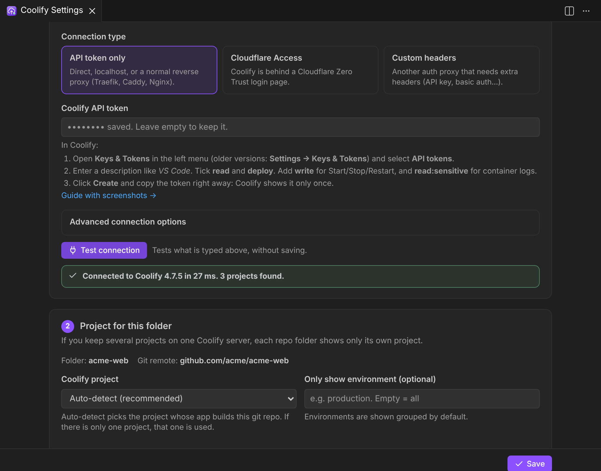

### 4. Open your repo

Open the folder of a repo that Coolify deploys. The dashboard finds its project by the git remote. If it can't, it asks once and remembers. → **[Several projects & repos](docs/multiple-projects.md)**

More setups: **[Localhost, IP-only, homelab, VPN](docs/localhost-and-direct.md)** · **[Troubleshooting](docs/troubleshooting.md)**

## Set up with AI

Prefer to be walked through it? Copy this prompt into **Claude**, **ChatGPT**, **Cursor chat** or any assistant. It interviews you about your setup and guides you step by step. (Inside VS Code, **Coolify: Copy AI Setup Prompt** copies the same text with your current state filled in. It never includes your token or secrets.)

```text
You are helping me set up the "Coolify Deploy Dashboard" extension for VS Code (also works in Cursor, VSCodium and Windsurf). Be my patient, step-by-step setup guide.

How to guide me:
- First ask me the questions below, ONE at a time, and wait for my answer before moving on.
- Then give me numbered steps. Keep each step short. Tell me exactly what to click and what I should see when it worked.
- After each step, ask me to confirm, or to paste the error message I got. Then help me fix it.
- Never ask me to paste my API token, Cloudflare secret or any password into this chat. I will type those only into the extension's Settings page.

Questions to ask me first:
1. What address do I type in the browser to open my Coolify dashboard? (For example https://coolify.example.com, http://203.0.113.10:8000 or http://localhost:8000.)
2. When I open that address in a private/incognito window, do I see the Coolify login page directly, or a Cloudflare Access login page (or another login page like Authelia, Authentik or basic auth) first?
3. Which version of Coolify do I run? (It is shown at the bottom of the left menu in Coolify.)
4. Do I have one Coolify project, or several? Is each project a different git repo that I open as a different folder in VS Code?
5. Optional extras: do I want a command (like `npm run build`) to run before every deploy, a "Merge & Deploy" button (merge e.g. `development` into `main`, push, deploy), or buttons to start my local dev servers?

Facts about the extension (use these, do not guess):
- Open its settings with the gear icon in the Coolify sidebar, or Command Palette (Ctrl/Cmd+Shift+P) → "Coolify: Open Settings".
- Connection fields: "Server URL" (the address from question 1, without /api/v1), "Connection type" and "API token".
- Connection types:
  - "API token only" for a direct connection or a normal reverse proxy.
  - "Cloudflare Access" adds the headers CF-Access-Client-Id and CF-Access-Client-Secret from a Cloudflare service token.
  - "Custom headers" for other auth proxies (e.g. an API key header or `Authorization: Basic …` for basic auth). In this mode the Coolify token still goes in "API token".
- "Allow self-signed certificates" is for servers with an untrusted HTTPS certificate (homelab/LAN).
- The "Test connection" button explains failures in plain words. Ask me to read you its message.
- Secrets are stored in the operating system keychain (VS Code SecretStorage), not in settings.json.

Where to get the Coolify API token (Coolify v4):
1. In Coolify open "Keys & Tokens" in the left menu, then "API Tokens".
2. If a yellow box says "API access is turned off", click "Enable API Access". This opens Settings → Advanced: set "API access" to "Enabled" (newer versions save it straight away; older ones need "Save"). If "Allowed IPs" is filled in there, my IP must be in it.
3. Back on Keys & Tokens → API Tokens, click "New Token". Description: "VS Code". Expires in: pick what suits me (the default is 30 days; the extension will stop working when it expires).
4. Under "Permissions" tick "Read" and "Deploy". Add "Write" for Start/Stop/Restart and "Read sensitive data" for container logs. Never tick "Root" for this. Leave "Access" on "All resources in the team" unless I want to limit it.
5. Click "Create Token" and copy the token right away. It is shown only once and looks like `2|aBcD…`.

If my Coolify is behind Cloudflare Access:
1. Cloudflare dashboard → Zero Trust → Access → Service Auth → Service Tokens → "Create Service Token". Name it (e.g. "vscode-coolify"), pick a duration, create it, and copy the Client ID and Client Secret (the secret is shown only once).
2. Zero Trust → Access → Applications → open the application that protects the Coolify hostname → Policies → add a policy with Action = "Service Auth", Include → "Service Token" → pick the new token. Save. (A normal "Allow" policy does not work for service tokens.)
3. In the extension choose "Cloudflare Access" and paste the Client ID and Client Secret, plus the Coolify API token.

Several projects / repos:
- One install connects to one Coolify server. Each VS Code folder shows only its own Coolify project.
- It is detected automatically when a Coolify app in that project builds the folder's git repo (git remote "origin").
- If it cannot be detected, the sidebar shows a project picker and remembers the choice for that folder.
- To share the choice with a team, set "coolify.projectUuid" in that folder's .vscode/settings.json (the UUID is in the Coolify URL: /project/<uuid>).
- "coolify.environment" can limit the view to one environment, e.g. "production".

Optional features (all off by default), set in the Settings page or settings.json:
- "coolify.preDeploy.command" (+ "coolify.preDeploy.cwd"): runs before each deploy; if it fails, the deploy stops.
- "coolify.merge.enabled", "coolify.merge.sourceBranch", "coolify.merge.targetBranch", "coolify.merge.remote": the Merge & Deploy button.
- "coolify.localServices": a list like [{ "name": "Web", "command": "npm run dev", "cwd": "web", "port": 3000 }] for the Localhost section.

Common errors and fixes:
- 401: the token is wrong or was deleted. Create a new one.
- 403 "API is disabled": set "API access" to Enabled in Coolify → Settings → Advanced.
- 403 or a redirect to cloudflareaccess.com: the Cloudflare service token or "Service Auth" policy is missing.
- "web page instead of the Coolify API": the URL points at a login page or the wrong site.
- Connection refused: wrong port (a fresh Coolify uses 8000) or Coolify is not running.
- Certificate not trusted: use a valid certificate or turn on "Allow self-signed certificates".
- Empty dashboard: the folder is linked to the wrong project. Use "Coolify: Select Project for This Folder".

Start now with question 1.
```

## How it works

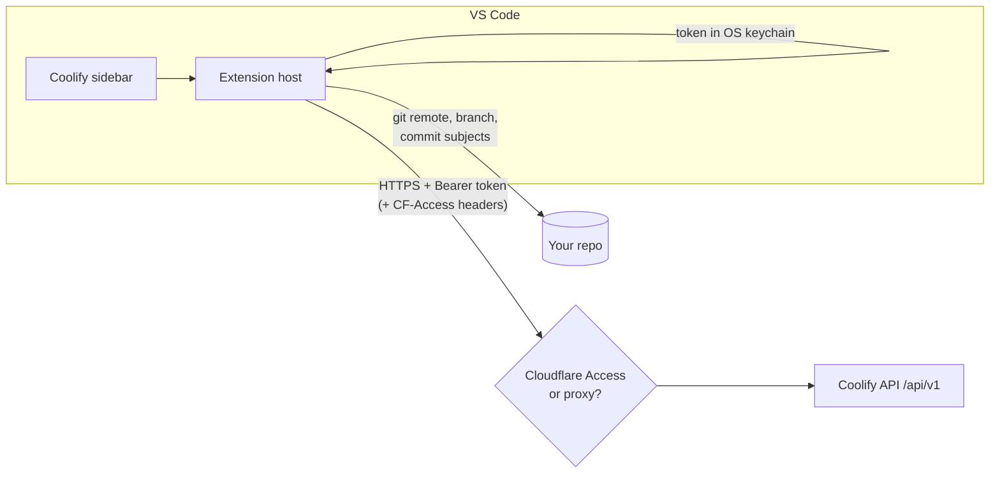

**Finding the project for a folder.** Coolify's list endpoints don't say which project a resource belongs to. They only return an `environment_id`. So for the open folder the extension:

1. picks the project: `coolify.projectUuid` setting → your remembered choice → **apps whose git repository equals this folder's `origin`** → the only project → otherwise asks;
2. reads that project's environments (cached 5 min);
3. fetches **all resources in one request** (`GET /resources`) and keeps those whose `environment_id` belongs to the project.

No name guessing, so look-alike names in other projects never leak in. [More detail](docs/multiple-projects.md)

**What a refresh costs:** one `/resources` call, plus one small deployments call per application (`take=5`). Build logs are fetched only once per new finished deployment, to detect hidden build failures, and the result is cached.

## Using the dashboard

<table>
<tr>
<td width="33%">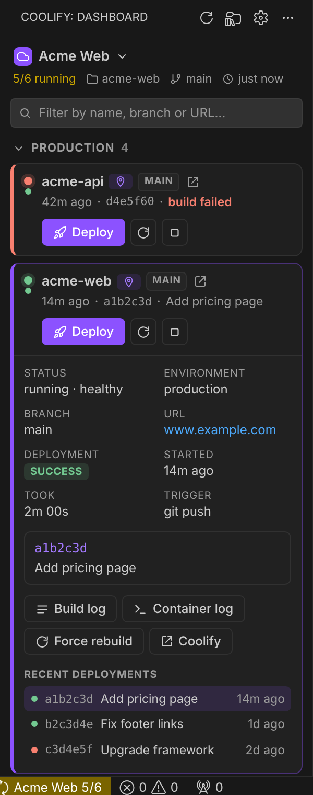</td>
<td width="33%">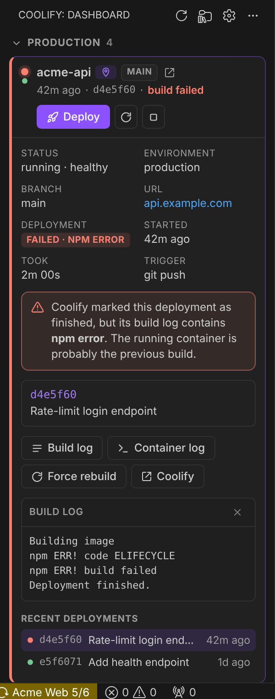</td>
<td width="33%">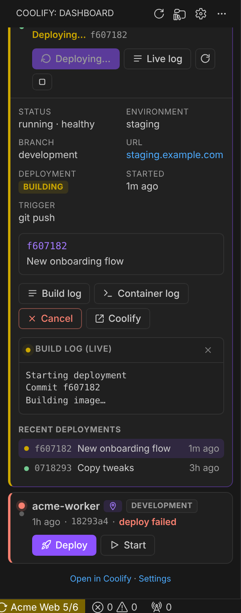</td>
</tr>
<tr>
<td>Resources grouped by environment</td>
<td>"Finished" deploy with a build error, flagged</td>
<td>Live build log while deploying</td>
</tr>
</table>

**Each row**

- **Top dot: container.** 🟢 running · 🟡 deploying/starting · 🔴 stopped, or the last deployment failed · grey unknown.
- **Small dot: health check** reported by Coolify (healthy / unhealthy / unknown).
- **Left edge:** purple = this app builds the repo you have open, amber = deploying, red = failed.
- **Subline:** `14m ago · a1b2c3d · Add pricing page`, or *Deploying…*, *build failed*, *exited*.
- **Buttons:** Deploy (or a disabled *Deploying…* with **Live log**), Restart, Stop / Start. Click the row for details.

**Expanded row:** status, environment, branch, URLs, last deployment (status, start time, duration, trigger: git push / API / manual), commit link, **Build log**, **Container log**, **Force rebuild**, **Cancel** (while running), **Open in Coolify**, and the last five deployments. Click one to inspect it.

**Header:** project switcher, `running/total`, folder, git branch, last refresh. The filter box appears when there are more than 5 resources.

**Themes:** every color comes from your VS Code theme.

| Dark | Light | High Contrast | High Contrast Light |
|---|---|---|---|
|  | 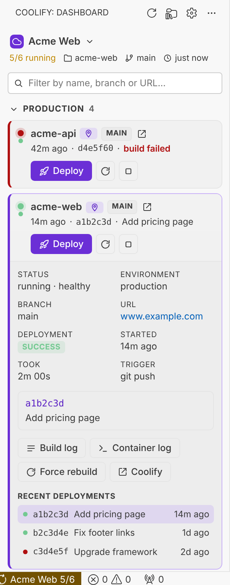 | 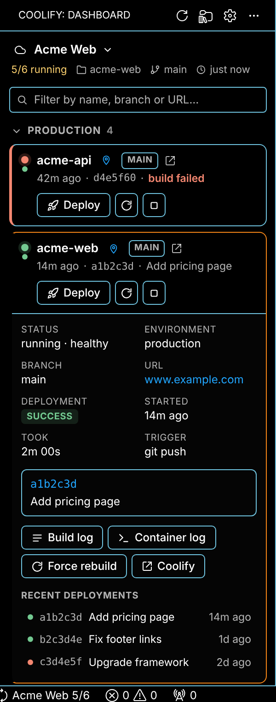 | 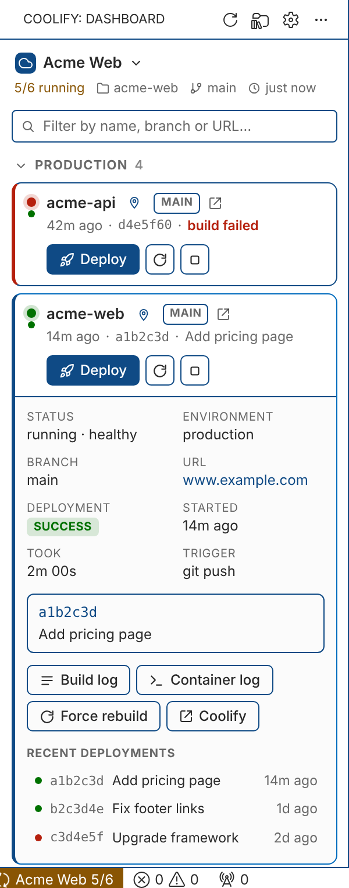 |

## Optional features

All are off by default and saved **per folder** (`.vscode/settings.json`), because every repo is different. Turn them on in **Coolify: Open Settings → Optional features**, or in settings.json:

### Pre-deploy command

```jsonc
{
  "coolify.preDeploy.command": "npm run build",
  "coolify.preDeploy.cwd": "web"      // optional, relative to the repo
}
```

Runs before **Deploy** and **Merge & Deploy**. If it fails you see the first real error (ESLint, TypeScript, Vite/esbuild and npm output are understood), and the deploy stops. You can still choose *Deploy anyway*. Full output is in **Output → Coolify**.

### Merge & Deploy

```jsonc
{
  "coolify.merge.enabled": true,
  "coolify.merge.sourceBranch": "development",
  "coolify.merge.targetBranch": "main",
  "coolify.merge.remote": "origin"
}
```

Apps whose Coolify branch equals the target branch get a **Merge & Deploy** button. It shows how many commits the target is behind. Clicking it fetches, fast-forwards the target, merges the source, pushes, deploys, and returns you to your branch. It refuses to run with uncommitted changes to tracked files, and aborts cleanly on conflicts.

### Localhost (local dev services)

```jsonc
{
  "coolify.localServices": [
    { "name": "Web", "command": "npm run dev", "cwd": "web", "port": 3000 },
    { "name": "API", "command": "npm run start:dev", "cwd": "api", "port": 8080 }
  ]
}
```

Start and stop each one in its own terminal; the dot shows whether the port is up. → [details](docs/localhost-and-direct.md#localhost-section-run-your-own-app-locally)

> In folders you haven't trusted (VS Code *Workspace Trust*), the pre-deploy command and local services are ignored, so a cloned repo can't run commands on your machine.

## Settings reference

Connection settings are per machine (User settings). Secrets are **not** settings: they live in the OS keychain and are edited on the settings page.

| Setting | Default | Scope | Description |
|---|---|---|---|
| `coolify.serverUrl` | `""` | machine | Address of your Coolify, e.g. `https://coolify.example.com` |
| `coolify.authMode` | `token` | machine | `token` · `cloudflare` · `headers` |
| `coolify.allowSelfSignedCerts` | `false` | machine | Accept untrusted HTTPS certificates (homelab) |
| `coolify.requestTimeoutSeconds` | `15` | machine | Per-request timeout |
| `coolify.projectUuid` | `""` | folder | Pin this folder to a project (empty = auto-detect) |
| `coolify.environment` | `""` | folder | Show only one environment, e.g. `production` |
| `coolify.refreshIntervalSeconds` | `30` | user | Refresh interval while visible (5 s during a deployment) |
| `coolify.statusBar.enabled` | `true` | user | Show `Project running/total` in the status bar |
| `coolify.confirmDeploy` | `true` | user | Ask before deploy / stop / restart |
| `coolify.preDeploy.command` | `""` | folder | Command to run before deploys |
| `coolify.preDeploy.cwd` | `""` | folder | Folder for that command |
| `coolify.preDeploy.timeoutMinutes` | `10` | folder | Stop the command after this long |
| `coolify.merge.enabled` | `false` | folder | Show Merge & Deploy |
| `coolify.merge.sourceBranch` | `development` | folder | Branch that gets merged |
| `coolify.merge.targetBranch` | `main` | folder | Branch that is deployed |
| `coolify.merge.remote` | `origin` | folder | Remote to fetch/push |
| `coolify.localServices` | `[]` | folder | Local dev servers for the Localhost section |

## Commands

| Command | What it does |
|---|---|
| **Coolify: Open Settings** | Setup wizard, connection test, project, optional features |
| **Coolify: Refresh Dashboard** | Refresh now (also re-fetches git) |
| **Coolify: Select Project for This Folder** | Pick or reset the project for the open folder |
| **Coolify: Quick Deploy** | Pick an app → Deploy / Force rebuild, from the Command Palette |
| **Coolify: Show Deployment History** | Pick an app and a deployment → full log in the Output panel |
| **Coolify: Open Project in Coolify** | Open the project in your browser |
| **Coolify: Run Pre-Deploy Command** | Run the pre-deploy check without deploying |
| **Coolify: Copy AI Setup Prompt** | Copy the guided-setup prompt (no secrets) |
| **Coolify: Forget Saved Credentials** | Remove token and secrets from the keychain |

## Privacy & performance

- **Your data stays between VS Code and your Coolify.** No telemetry, no third-party servers.
- **Secrets** (API token, Cloudflare secret, custom header values) are stored with VS Code SecretStorage, i.e. your OS keychain. Older plain-text settings (`coolify.apiToken` …) are moved there automatically and removed from `settings.json`.
- **Connection settings can't be set by a repo.** `serverUrl` and `authMode` are machine-scoped, so a malicious `.vscode/settings.json` can't redirect your token to another server.
- **Light on resources:** activates after startup and does nothing until configured; polls only while the sidebar is visible (the status bar refreshes every 2 minutes while the window is focused); never overlaps requests; caches project environments, commit subjects and build-log scans; `git fetch` at most every 5 minutes.
- **Safe API use:** deploys always use `POST /deploy`. Coolify also treats `GET /deploy` as "deploy now", so the extension never calls it.
- Small: one ~130 KB bundled file, no runtime dependencies to install.

## Troubleshooting

| Message | Fix |
|---|---|
| *The API token was rejected (401)* | Create a new token (they expire; default 30 days) |
| *The Coolify API is turned off on this server (403)* | Coolify → Settings → Advanced → **API access: Enabled** |
| *Cloudflare Access redirected the request to its login page* | Choose *Cloudflare Access* and add a service token + **Service Auth** policy → [guide](docs/cloudflare-access.md) |
| *The server answered with a web page…* | Wrong URL or connection type |
| *Connection refused* | Wrong port (fresh installs use `:8000`) or Coolify not running |
| *Certificate not trusted* | Fix the certificate, or *Allow self-signed certificates* |
| Wrong project shown | Click the project name at the top of the sidebar |

→ **[All errors and fixes](docs/troubleshooting.md)**

## FAQ

**Does it work with Coolify Cloud?** Yes. Use `https://app.coolify.io` as the Server URL and a token from your Cloud dashboard.

**Several Coolify servers?** One install connects to one server. If you use two servers, use VS Code [Profiles](https://code.visualstudio.com/docs/editor/profiles), one per server.

**Coolify v3?** No. It needs Coolify v4 (the `/api/v1` API).

**Does it need the Coolify MCP server?** No. Only the REST API.

**Where does "commit message" come from?** From Coolify when it provides one; otherwise from your local git history (no network).

## Development

```bash
git clone https://github.com/Rahulcode97/Coolify-VScode-Dashboard.git
```

```bash
cd Coolify-VScode-Dashboard && npm install
```

```bash
npm run build && npm test
```

- Press <kbd>F5</kbd> in VS Code to launch an Extension Development Host.
- **No Coolify handy?** Run the bundled fake API (3 projects, several environments, live deployments) and connect to `http://127.0.0.1:8765` with the token `test-token`:

```bash
node test/mock-coolify.mjs
```

- **Check against your own Coolify** (read-only, never deploys):

```bash
COOLIFY_URL=https://coolify.example.com COOLIFY_TOKEN=xxxx npm test -- live
```

- `npm run check:leaks` and `npm run check:secrets` run in CI. Please keep examples generic (`example.com`, `203.0.113.x`, `acme-*`).

Project layout: `src/api` (Coolify client) · `src/projects.ts` (project resolution) · `src/dashboardData.ts` (state for the webview) · `src/views` (webview providers) · `media/` (webview UI, plain JS/CSS) · `test/` (vitest + mock server). Publishing: [docs/publishing.md](docs/publishing.md).

Issues and pull requests are welcome. ⭐ If this saves you a trip to the browser, a star helps others find it.

## License

[MIT](LICENSE) © Rahulcode97

*Coolify is a trademark of its respective owner. This is an independent, community-made extension and is not affiliated with or endorsed by the Coolify project.*
