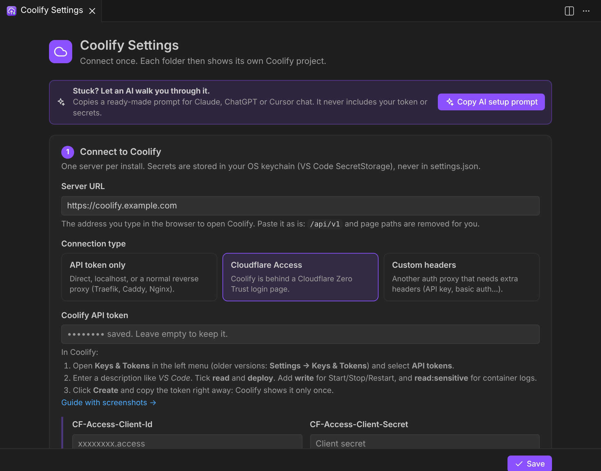

# Coolify behind Cloudflare Access

Use this guide if opening your Coolify address in a private window shows a **Cloudflare login page** first.

Cloudflare Access blocks every request without a login, including the extension's API calls. The fix is a **service token**: a Client ID + Client Secret pair that the extension sends as the `CF-Access-Client-Id` and `CF-Access-Client-Secret` headers on every request.

You need two things:

1. A Coolify API token. See [Get your Coolify API token](getting-the-api-token.md).
2. A Cloudflare service token, plus a **Service Auth** policy that accepts it.

## 1. Create a service token

1. Open the [Cloudflare dashboard](https://dash.cloudflare.com/) → **Zero Trust** → **Access controls** → **Service credentials** → **Service Tokens**.
2. Click **Create Service Token**.
3. Name it, e.g. `vscode-coolify`.
4. Choose a **Service Token Duration**. When it expires the extension starts reporting *Cloudflare Access redirected the request to its login page*.
5. Click **Generate token**.
6. Copy the **Client ID** (ends in `.access`) and the **Client Secret**. Cloudflare shows the secret **only once**.

> Older dashboards: **Zero Trust → Access → Service Auth → Service Tokens**.

## 2. Let the token through: add a Service Auth policy

A service token alone does nothing. The Access application that protects your Coolify hostname needs a policy that accepts it.

1. **Zero Trust** → **Access controls** → **Applications** → open the application for your Coolify hostname (e.g. `coolify.example.com`) → **Policies**.
2. Add a policy:
   - **Action: Service Auth.** This matters: with *Allow*, Cloudflare still asks for a human login and the extension gets the login page.
   - **Include → Service Token →** the token you just created.
3. Save. Make sure the policy is assigned to the application.

Your normal *Allow* policy for people stays as it is. Service Auth policies are checked first.

## 3. Enter everything in VS Code

1. **Coolify: Open Settings** (or the gear in the Coolify sidebar).
2. **Server URL**: the protected address, e.g. `https://coolify.example.com`.
3. **Connection type: Cloudflare Access.**
4. **Coolify API token**: from Coolify (Keys & Tokens → API Tokens).
5. **CF-Access-Client-Id** and **CF-Access-Client-Secret**: from step 1.
6. **Test connection**, then **Save**.

All three secrets go into your OS keychain (VS Code SecretStorage).

## What the errors mean

| Message in the extension | Cause | Fix |
|---|---|---|
| *Cloudflare Access redirected the request to its login page* | Missing or wrong service token, or no **Service Auth** policy | Check Client ID/Secret; add the Service Auth policy (step 2) |
| *Cloudflare blocked the request (403)* | Token not included in the policy, expired, or a WAF rule blocked it | Include the token in the policy; renew it; check Security → Events in Cloudflare |
| *The server answered with a web page instead of the Coolify API* | Connection type is not *Cloudflare Access*, or the URL points somewhere else | Choose *Cloudflare Access*; check the URL |
| *The API token was rejected (401)* | Cloudflare let you through, but the **Coolify** token is wrong | Create a new Coolify token |

## Other login proxies (Authelia, Authentik, oauth2-proxy, basic auth…)

Choose **Custom headers** as the connection type and add whatever header your proxy accepts for machines, for example:

- an API key header such as `X-Api-Key: …`
- basic auth: header `Authorization`, value `Basic <base64 of user:password>`. This replaces the Coolify bearer token, so only use it if your proxy strips it again. Usually a dedicated machine header is the better choice.

The Coolify API token is still required and is sent as `Authorization: Bearer …` unless you override that header.
