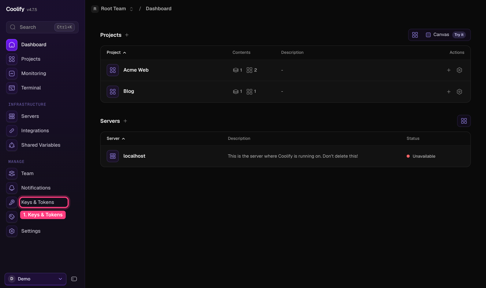
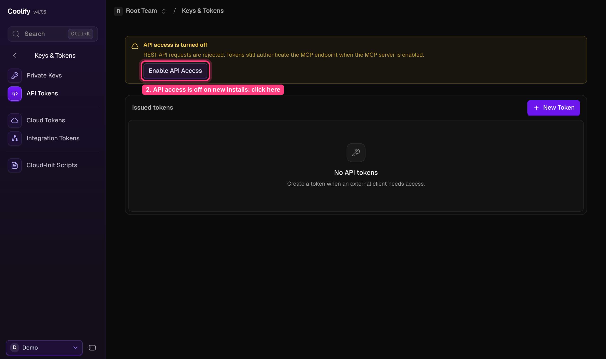
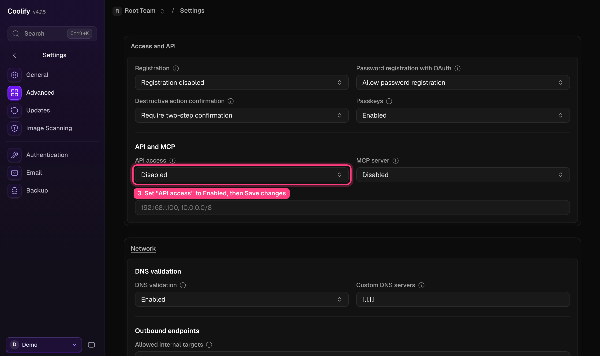
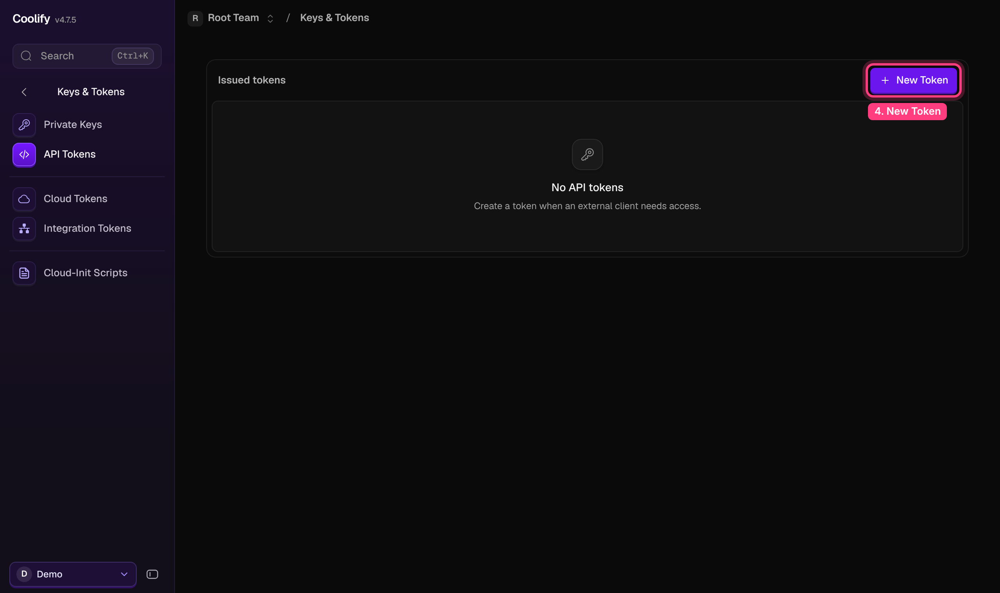
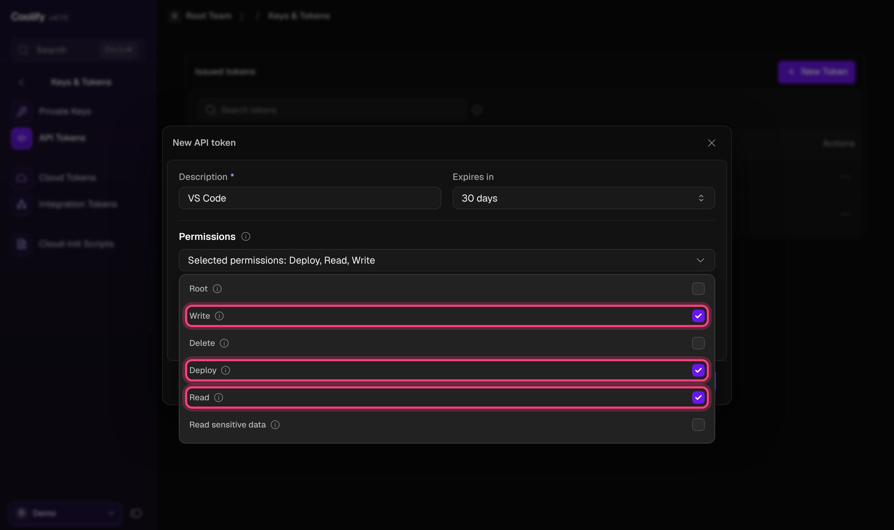
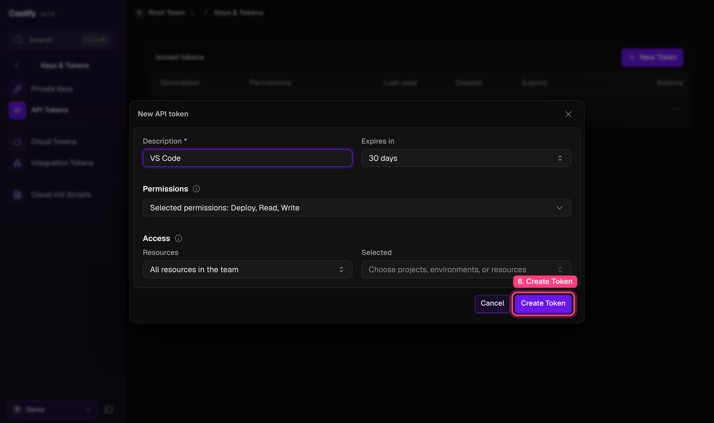
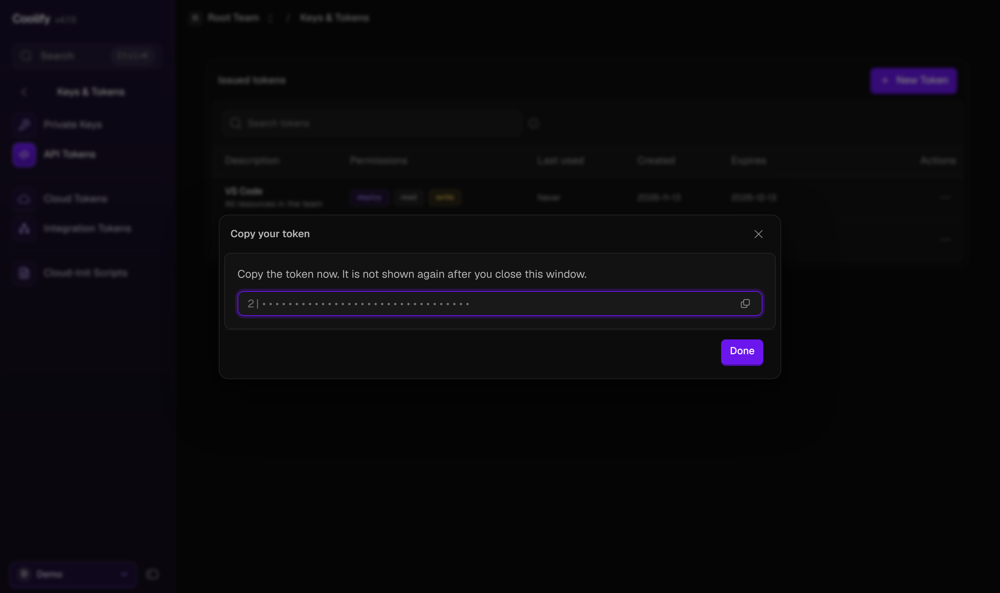
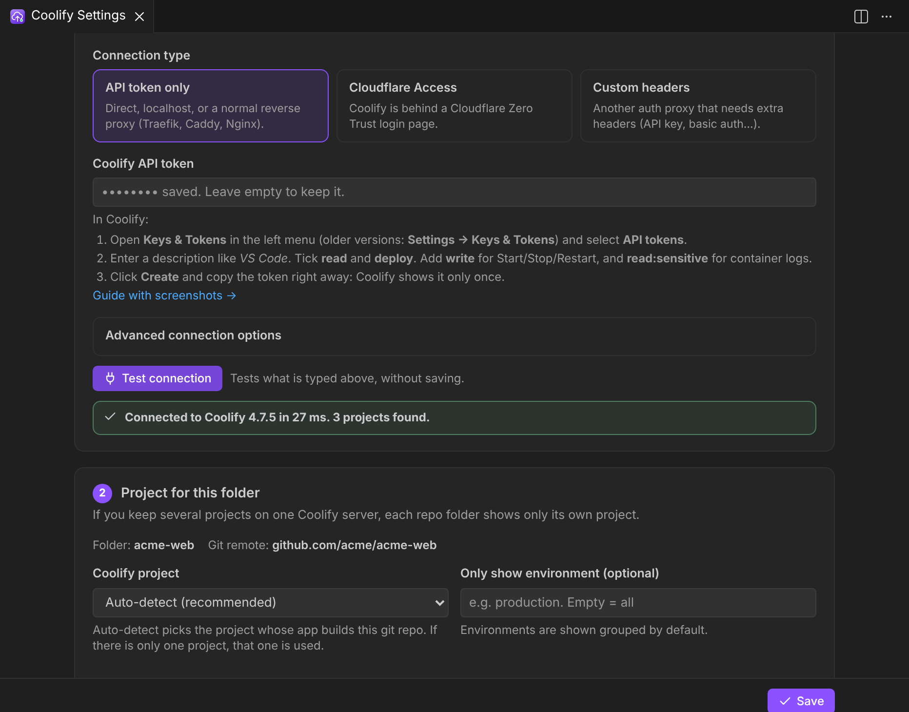

# Get your Coolify API token

The extension talks to Coolify through its REST API. To use it you need an **API token** from your Coolify dashboard. This takes about two minutes.

> Screenshots are from Coolify **v4.7.5**. Older v4 builds have the same pages; only some labels differ (see the notes under each step).

## 1. Open Keys & Tokens

Sign in to Coolify and click **Keys & Tokens** in the left menu.

> Older v4 builds: **Settings → Keys & Tokens**, or the **Security** menu.

## 2. Make sure the API is turned on (only once per server)

Open **API Tokens**. On a fresh install a yellow box says **API access is turned off**. Click **Enable API Access**.

That button opens **Settings → Advanced**. Set **API access** to **Enabled**. Newer versions save this at once; if you see a **Save changes** bar, click it.

- **Allowed IPs**: leave it empty to allow every address. If you fill it in, add the public IP of every computer that runs VS Code, or you will get *403 Forbidden*.
- If the extension later reports **"The Coolify API is turned off on this server (403)"**, this is the switch to check.

## 3. Create a token

Go back to **Keys & Tokens → API Tokens** and click **New Token**.

Fill in the form:

| Field | What to choose |
|---|---|
| **Description** | Something you will recognise later, e.g. `VS Code (laptop)` |
| **Expires in** | The default is 30 days. When the token expires the extension shows *401 token rejected*, and you create a new one. Pick a longer period if you prefer. |
| **Permissions** | **Read** + **Deploy** are required. Add **Write** to use Start / Stop / Restart. Add **Read sensitive data** to see container (runtime) logs. **Never pick Root**: the extension does not need it. |
| **Access → Resources** | **All resources in the team** is the simplest choice. You can limit it to selected projects; the dashboard then shows only those. |

Click **Create Token**.

## 4. Copy the token now

Coolify shows the token **only once**. Copy it with the copy icon. It looks like `2|AbCdEf…`, a number, a `|`, then a long string.

If you lose it, delete it in the token list and create a new one.

## 5. Paste it into VS Code

1. Click the **Coolify** icon in the Activity Bar (the cloud with an arrow).
2. Click **Connect** (or run **Coolify: Open Settings** from the Command Palette, <kbd>Ctrl/Cmd</kbd>+<kbd>Shift</kbd>+<kbd>P</kbd>).
3. **Server URL**: the address you open Coolify at, e.g. `https://coolify.example.com` or `http://203.0.113.10:8000`.
4. **Connection type**: *API token only*, unless Coolify sits behind Cloudflare Access ([see that guide](cloudflare-access.md)) or another login proxy.
5. Paste the token into **Coolify API token**.
6. Click **Test connection**. You should see *Connected to Coolify 4.x… N projects found.*
7. Click **Save**.

The token is stored in your operating system's keychain (VS Code *SecretStorage*), never in `settings.json`, so it is not synced into repositories.

## Which permission does what?

| Extension feature | Coolify permission |
|---|---|
| See projects, apps, services, databases, deployments, build logs | Read |
| Deploy, Force rebuild, Merge & Deploy, Cancel deployment | Deploy |
| Start / Stop / Restart | Write |
| Container log button | Read sensitive data |

Stuck? Use **Copy AI setup prompt** in the extension's settings page, or [read the troubleshooting guide](troubleshooting.md).
