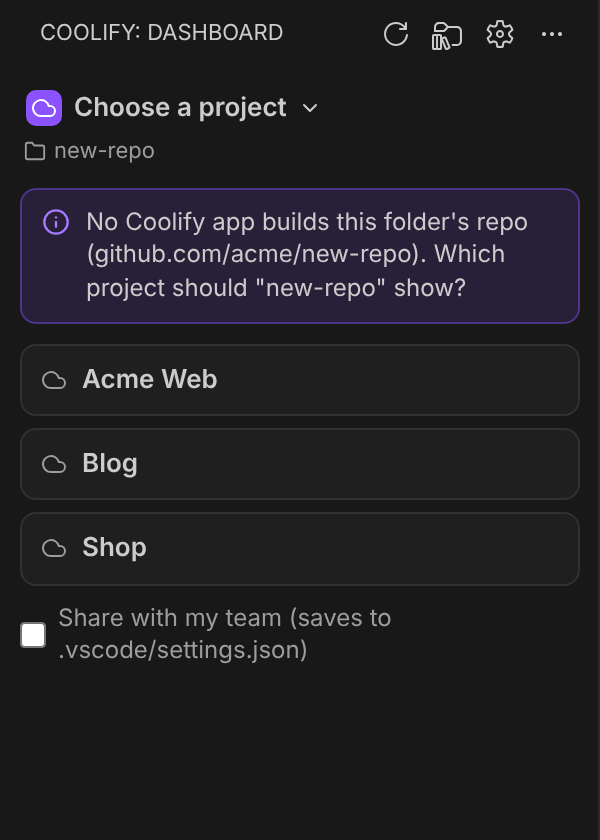

# Several projects and repos on one Coolify server

A common setup: one Coolify server, several **projects** (say *Acme Web*, *Blog*, *Shop*), each built from a different git repository that you open as a different folder in VS Code.

The extension connects to **one server**, and each folder shows **only its own project**.

| Folder open in VS Code | Git remote | Dashboard shows |
|---|---|---|
| `~/code/acme-web` | `github.com/acme/acme-web` | Acme Web (production + staging) |
| `~/code/blog` | `github.com/acme/blog` | Blog |
| `~/code/side-project` | not deployed by Coolify | asks once, then remembers |

## How the project is chosen

For the folder you have open, the extension tries these in order and stops at the first that gives an answer:

1. **`coolify.projectUuid` in the folder's settings** (`.vscode/settings.json`). Use this to share the choice with your team.
2. **The choice you made in the picker** for this folder (remembered on your machine).
3. **Git remote match:** Coolify apps whose repository equals the folder's `origin` remote (`https://…`, `git@…:` and `owner/repo` forms all match). If they all live in one project, that project is used.
4. **Only one project** on the server: that one.
5. Otherwise the sidebar shows a **project picker**, with projects that build this repo starred.



Switch at any time with the project name at the top of the sidebar, or **Coolify: Select Project for This Folder**.

## Why this is reliable

Coolify's list endpoints do **not** say which project a resource belongs to. They only return an `environment_id`. The extension therefore:

1. reads the project's environments (`GET /projects/{uuid}`, cached for 5 minutes),
2. fetches every resource in one request (`GET /resources`),
3. keeps the resources whose `environment_id` belongs to that project.

There is no name guessing, so apps with similar names in different projects never mix.

## Share the choice with your team

In the picker or on the settings page, tick **Share with my team**. This writes:

```jsonc
// .vscode/settings.json
{
  "coolify.projectUuid": "abc123project000000000001"
}
```

The UUID is also in the browser address bar when you open the project in Coolify: `…/project/<uuid>/…`.

## Only show one environment

Projects with *production* and *staging* show both, grouped. To show one:

```jsonc
{ "coolify.environment": "production" }
```

## Multi-root workspaces

In a workspace with several folders, the dashboard follows the folder of the **active editor**: open a file from `blog/` and the sidebar switches to the Blog project.
