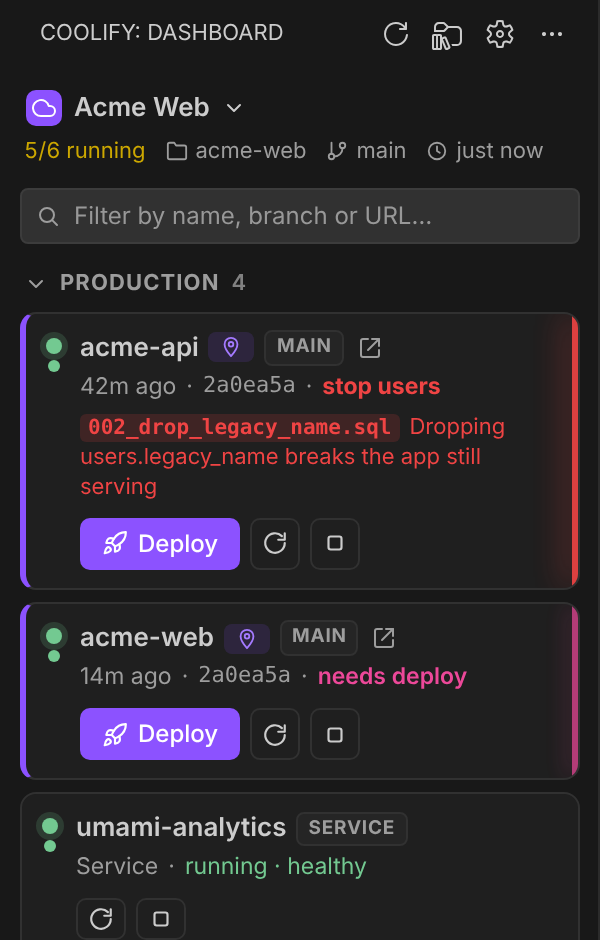
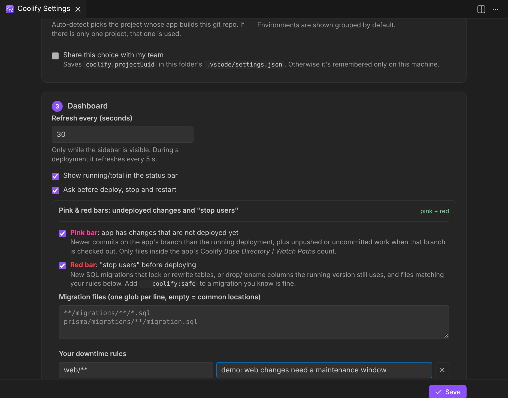

# Pink and red bars: "needs deploy" and "stop users"

Apps that build the repo you have open get an extra light on their **right edge**:

| | Means | Subline |
|---|---|---|
| **Pink bar** (slow pulse) | This app has changes that are **not deployed yet** | *needs deploy* |
| **Red bar** (fast pulse) | Deploying those changes now would **disturb people using the app**: stop users (or pick a quiet moment) first | *stop users* + the reasons |



Both are on by default. Turn them off per folder in **Coolify: Open Settings → Dashboard**, or with `coolify.deployRisk.pendingBar` / `coolify.deployRisk.stopUsersCheck`.

## When does an app turn pink?

The extension compares the commit Coolify deployed last (the newest *finished* deployment) with your local git:

1. **Newer commits on the app's branch.** For an app that builds `main`: commits on `origin/main` (or local `main` if there is no remote branch) after the deployed commit.
2. **Unpushed commits.** Only when that branch is checked out.
3. **Uncommitted or untracked files.** Also only when that branch is checked out.

Only files that would change **that** app count:

- **Base Directory**: an app with Base Directory `/web` turns pink only for changes under `web/`. This makes monorepos work: the frontend and the API app each react to their own folder.
- **Watch Paths**: if you set Watch Paths in Coolify (e.g. `src/**`), only matching files count.

If the deployed commit is not in your local history (shallow clone, a commit from another fork), the bar simply stays off. `git fetch` runs at most every 5 minutes; **Refresh** fetches now.

Hover the row (or expand it) to see why, e.g. *"2 commits on main not deployed (touching api/) · uncommitted changes in api/ (1 file)"*.

## When does it turn red?

### 1. A new SQL migration that is unsafe while the app is running

During a Coolify deploy the **old container keeps serving** while the new one starts and runs its migrations. Some SQL locks tables, so requests hang, or changes the schema under the old code, so requests fail.

The checker reads only migration files that are **new** since the deployed commit; migrations that already ran are never re-run. It flags:

| Pattern | Why it hurts |
|---|---|
| `DROP COLUMN`, `RENAME` (column or table), `DROP TABLE` | Old container still uses the old name/column |
| `ADD COLUMN … NOT NULL` without a constant default | Fails or locks on tables with rows |
| `ADD COLUMN … DEFAULT now()` (non-constant default) | Rewrites the whole table under a lock |
| `ALTER COLUMN … TYPE`, `MODIFY` | Usually rewrites the table |
| `SET NOT NULL`, `ADD CONSTRAINT` without `NOT VALID`, `VALIDATE CONSTRAINT` | Scans every row under a lock |
| `CREATE INDEX` without `CONCURRENTLY` | Blocks writes while building |
| `UPDATE`, `DELETE`, `TRUNCATE`, `INSERT … SELECT`, `COPY … FROM` on existing tables | Locks live rows during the deploy |
| `LOCK TABLE`, `REINDEX`, `CLUSTER`, `VACUUM FULL`, `REFRESH MATERIALIZED VIEW` | Explicit locks or rewrites |
| Renaming or dropping an enum value | Rows and old code still use it |

Things that are fine are not flagged: new tables (and indexes or changes on tables created in the same file), nullable columns, constant defaults, `CREATE INDEX CONCURRENTLY`, `NOT VALID` constraints, plain seed `INSERT … VALUES`, functions and views. Statements inside `DO $$ … $$` blocks are checked too.

**Where migrations are looked for** (`coolify.deployRisk.migrationGlobs`; empty = these defaults):

```text
**/migrations/**/*.sql
**/migrate/**/*.sql
**/db/migrate/**/*.sql
prisma/migrations/**/migration.sql
supabase/migrations/*.sql
drizzle/**/*.sql
```

**Silence a migration you know is fine** (a tiny table, or you deploy at night) by adding this comment anywhere in the file:

```sql
-- coolify:safe
ALTER TABLE feature_flags DROP COLUMN old_flag;
```

### 2. Your own "needs downtime" rules

Some changes need a quiet moment for reasons the checker can't see. Add rules for this folder in the settings page, or in `.vscode/settings.json`:

```jsonc
{
  "coolify.deployRisk.downtimeRules": [
    { "pattern": "docker-compose.yml", "reason": "recreates all containers" },
    { "pattern": "api/src/auth/**", "reason": "logs everyone out" },
    { "pattern": "*.env.example", "reason": "new env vars must be set in Coolify first" }
  ]
}
```

A pending change that touches a matching file turns the app red and shows your reason.



## Good to know

- The bars only appear on apps that **build the open repo** (the purple left edge). Apps from other repos, databases and services never get them.
- While an app is deploying, the bar is hidden; the amber "Deploying…" state takes over. After a successful deploy the next refresh clears the pink bar.
- Everything runs locally with `git`; nothing is sent anywhere. Results are cached, so a refresh only re-runs a few quick git commands.
